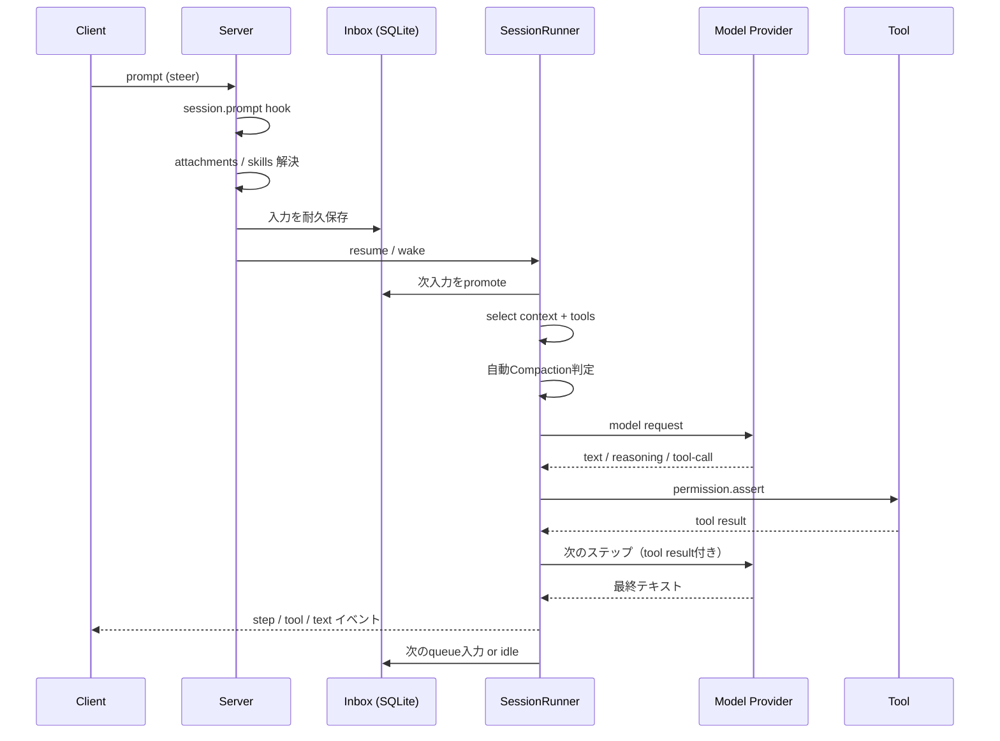

## セッション・ステップ・ツール・権限・圧縮の内部設計

---

## はじめに

OpenCodeは、ターミナル・デスクトップ・Webから使えるオープンソースのコーディングエージェントです。本記事では、OpenCode V2のAIエージェントが「どのように1回の依頼を処理し、モデルを呼び、ツールを実行し、長いセッションを維持しているのか」を、公式ドキュメントと `packages/core` の実装を突き合わせながら技術的に解説します。

対象は2026年11月時点のOpenCode V2です。V2はV1から設定名・API・プラグインAPIが変わっており、本記事の設定例はすべてV2のものです。実装は開発中のため、細部は将来変更される可能性があります。

本記事の中心となる問いは、次の3つです。

1. エージェントの「1ターン」は、どのような状態遷移で進むのか
2. LLMのツール呼び出しは、どこで検査され、どのように並列実行されるのか
3. 長い会話とクラッシュを、どうやって扱える状態に保っているのか

---

## 1. 全体像 — OpenCodeは「チャットUI」ではなく「エージェントランタイム」

OpenCodeの第一の特徴は、**クライアントとサーバーが分離されている**ことです。TUI、デスクトップアプリ、Web UIは表示と入力、承認操作を担当し、実際のセッション管理・モデル呼び出し・ツール実行はバックグラウンドのOpenCodeサーバーが担当します。

```text
┌─────────────────────────────┐
│ Client                      │
│  TUI / Desktop / Web        │
│  - 入力、表示、承認          │
└──────────────┬──────────────┘
               │ HTTP API + Event stream
┌──────────────▼──────────────┐
│ OpenCode Server             │
│                             │
│  Location                   │
│   ├─ Session store (SQLite) │
│   ├─ Session Inbox          │
│   ├─ Agent / Model registry │
│   ├─ Tool registry          │
│   ├─ Permission             │
│   ├─ Plugin hooks           │
│   └─ SessionRunner          │
│        ├─ Context assembly  │
│        ├─ Model request     │
│        └─ Step execution    │
└───────┬─────────────┬───────┘
        │             │
┌───────▼──────┐ ┌────▼──────────────┐
│ LLM Provider │ │ Tools / MCP / FS  │
└──────────────┘ └───────────────────┘
```

この分離によって、次のような性質が生まれます。

- クライアントを閉じても、サーバー側のセッションと実行状態は残る
- TUIとデスクトップで同じセッションを共有できる
- サブエージェントやバックグラウンドツールを、クライアントの接続状態と独立して動かせる
- クライアントはイベントストリームを購読する「ビュー」になれる

### 1.1 Location

OpenCodeの設定・セッション・ツールは、**Location**というディレクトリ／プロジェクト単位のスコープに紐づきます。Locationは単なるカレントディレクトリではなく、プロジェクトのルート、Gitワークツリー、ワークスペースIDなどを含む実行文脈です。

セッションはLocationに属し、必要なら別のディレクトリやワークツリーへ移動できます。移動は安全な境界で行われ、移動先に依存する処理は次の呼び出し以降に回されます。

### 1.2 Session

Sessionは、会話履歴・選択中のエージェント・モデル・権限・Inbox・実行状態をまとめた耐久単位です。V2では、セッションの状態はSQLiteに保存され、メッセージだけでなく「まだ処理されていない入力（Inbox）」や「実行中クレーム」も永続化されます。

この点が、単なる「会話履歴の配列」と大きく異なります。OpenCodeのセッションは、**クラッシュや再起動をまたいで再開できるワークフロー状態**を持っています。

### 1.3 Agent

Agentは、次の要素をまとめた名前付きプロファイルです。

- システムプロンプト
- 既定モデル（`provider/model#variant`）
- 権限ルール
- 最大ステップ数
- 表示名・色・说明
- サブエージェントとして使えるか（`mode`）

組み込みAgentには `build`、`plan`、`general`、`explore` があり、`title`、`summary`、`compaction` は内部保守用の非表示Agentです。

### 1.4 Provider / Model

OpenCodeはmodels.devのカタログ、プロバイダパッケージ、ユーザー設定を組み合わせてモデル一覧を作ります。モデル選択はセッション単位で保持され、エージェントを切り替えても、セッションが明示的に選んだモデルは維持されます。

### 1.5 Tool

Toolは、モデルに公開される関数です。ファイル読み書き、検索、シェル、Web、質問、スキル読み込み、サブエージェント起動、Code Modeの `execute` などがあります。Toolは「モデルが自由に呼べる関数」ではなく、**権限チェックと実行境界を通る能力**です。

### 1.6 Plugin

Pluginは、サーバー側でAgent、Model、Tool、Command、MCP、Skill、Referenceなどを変換（transform）し、実行中の操作にフック（hook）を差し込める拡張点です。OpenCodeのコアを fork せずに、組織固有のポリシーやツールを追加できます。

---

## 2. 1ターンのライフサイクル

ここで用語を整理します。

- **ターン（turn）**：ユーザーの入力が受理されてから、セッションがアイドルに戻るまで
- **ステップ（step）**：1回のモデルリクエストと、その応答に対するツール実行のまとまり

1ターンは複数ステップから成ります。モデルがツールを呼ぶたびにステップが進み、ツール結果を含めた次のリクエストが送られます。

### 2.1 プロンプトの受理（admission）

クライアントがプロンプトを送ると、サーバーはすぐにモデルを呼びません。まず**受理**を行います。

1. `session.prompt` プラグインフックが走る
2. 添付ファイルが実体化される（最大20 MiB）
3. 明示指定されたスキルが解決される
4. 入力が耐久Inboxに追加される

受理の時点で、入力は「まだ処理されていない作業」としてSQLiteに保存されます。同じIDの再送は最初の受理結果を返し、二重実行を防ぎます。

`delivery` には `steer` と `queue` があります。

| delivery | 意味 |
| --- | --- |
| `steer` | 実行中のステップ境界で割り込み、次のステップに反映する（既定） |
| `queue` | 現在のターンが終わってアイドルになったら処理する |

つまり、実行中に追加で指示を送ると、既定では**次のステップでその指示が会話に混ざります**。ターン全体の完了を待たせる `queue` とは挙動が異なります。

### 2.2 drain — 1ターンを進めるループ

サーバーはセッションごとに実行コーディネータを持ち、`drain` を呼びます。実装上、**1回のdrainが1ターン**です。

```text
drain
 ├─ Inboxから次に処理可能な入力を取り出す
 ├─ プラグインの有効化を待つ
 ├─ 中断された古いCompaction / Tool呼び出しを決着させる
 ├─ コンテキストを選択する
 │   ├─ Agent
 │   ├─ Model
 │   ├─ 指示（Instructions）
 │   └─ Toolスナップショット
 ├─ 自動Compactionが必要か判定する
 ├─ モデルリクエストを組み立てる
 ├─ ステップを実行する
 │   ├─ ストリーミング
 │   ├─ ツール呼び出し
 │   ├─ 権限チェック
 │   └─ ツール結果
 ├─ 続行が必要なら次のステップへ
 └─ 入力がなければアイドル
```

このループの重要な点は、**コンテキストの選択（select）と、モデルリクエストの組み立て（request）と、ステップ実行（attempt）が分離されている**ことです。

- `select`：セッション、エージェント、指示、ツールのスナップショットを固定する
- `load`：モデルと有効な履歴を解決する
- `request`：システムプロンプト、メッセージ、ツール定義をプロバイダ向けに組み立てる
- `attempt`：ストリーミング、ツール実行、リトライ、スナップショットを担当する

この分離により、モデルのリトライやCompactionが起きても、同じ選択済みコンテキストを再利用できます。

### 2.3 シーケンス図



### 2.4 実行クレームとクラッシュ復旧

セッションの実行開始時には、**write-ahead claim**（先書きの実行クレーム）が記録されます。これは「このターンは実行中である」という耐久的な意図であり、開始イベントと同じトランザクションで保存されます。

正常終了時にはクレームが解放されますが、サーバーがクラッシュした場合はクレームが残ります。次回起動時、OpenCodeはこれを「中断されたターン」として扱い、必要に応じて再開します。復旧はシャットダウンフックではなく、**データベースに残った状態**を根拠に行われます。

同様に、中断されたツール呼び出しやCompactionも、次のdrainで決着させられます。これにより、プロセスが突然死してもセッションが「runningのまま永久に固まる」状態を避けています。

---

## 3. プロンプトの組み立て

### 3.1 システムプロンプトは2つの部分から成る

モデルに送られるシステムプロンプトは、大きく2つに分かれます。

1. **Agentのシステムプロンプト**（または組み込みのベースプロンプト）
2. **Instructions**（プロジェクト指示、スキル、MCP、環境情報など）

組み込みのベースプロンプトは、概ね次のような内容です。

```text
You are an AI agent running in OpenCode, a coding agent harness.
Help the user accomplish their goals using the tools you have available.
...
```

さらに、利用可能なツールに応じてガイダンスが動的に挿入されます。たとえば `shell` があれば「専用ツールを優先し、シェルはフォールバックにする」、`edit` があれば「一意に一致する `oldString` を置換する」といった指示が追加されます。

この設計のポイントは、**ツールの有無に応じてプロンプトが変わる**ことです。読み取り専用のエージェントには編集用の指示を送らず、Code Modeが無効なエージェントにはCode Modeの説明を送りません。

### 3.2 Instructionsの順序

V2では、指示は次の順序で結合されます。

```text
1. Agentまたはプロバイダのシステムプロンプト
2. Code Modeのツールガイダンス（有効時）
3. MCPサーバー、Reference、Skillのガイダンス
4. グローバル／プロジェクトのAGENTS.md、設定されたinstructions
5. 組み込みの日付・環境コンテキスト
6. セッション固有の指示エントリ（API経由）
```

実装では、セッションの指示リストは「共有度の高いものから低いものへ」並べられます。

```text
Code Mode → MCP → References → Skills → AGENTS.md → 日付・環境 → セッション固有
```

これは**プロンプトキャッシュ**を意識した順序です。ユーザー全体で共有できる部分を前に、日付やディレクトリのように変わりやすい部分を後ろに置くことで、プロバイダ側のキャッシュ済みプレフィックスを再利用しやすくします。

### 3.3 AGENTS.mdの段階的読み込み

`AGENTS.md` は、グローバル設定と、ワークスペースから上位ディレクトリに向かって存在するファイルが最初に読み込まれます。さらに、エージェントがプロジェクト内のファイルを読んだりディレクトリを一覧したりすると、その対象とワークスペースの間にある `AGENTS.md` が**探索の進行に合わせて追加**されます。

```text
my-project/
├── AGENTS.md                  ← 最初に読み込まれる
└── packages/
    └── web/
        ├── AGENTS.md          ← この領域を読んだときに追加
        └── src/
            └── app.ts         ← 読み取り対象
```

ネストしたファイルは「近いものから先」に追加され、モデル可視の履歴から消えない限り重複して注入されません。Compactionやrevertで履歴から消えた場合は、再度読み込まれることがあります。

### 3.4 ツール定義とスナップショット

モデルに送られるツール定義は、登録済みツールから**権限でフィルタしたスナップショット**です。ツール定義はJSON Schemaに変換され、リクエストごとに固定されます。

- 直接公開されるツールは名前順に並べられる
- Code Modeが有効なら、個々のツールは `execute` ツールのカタログに入る
- `codemode: false` のツールは直接公開される
- リクエスト中にプラグインがツールを追加・削除しても、そのリクエストのスナップショットは変わらない

スナップショットを固定することで、1回のモデル呼び出しの中で「広告したツール」と「実行できるツール」が一致します。これはプロンプトキャッシュの安定性にも寄与します。

### 3.5 最大ステップ時のプロンプト

Agentに `steps` が設定されている場合、最終ステップではツール選択が `none` になり、次のようなプロンプトが注入されます。

```text
CRITICAL - MAXIMUM STEPS REACHED
...
1. Do NOT make any tool calls
2. MUST provide a text response summarizing work done so far
...
```

興味深いのは、**最終ステップでもツール定義自体は送り続ける**点です。ツール定義を消すとプロバイダのキャッシュ済みプレフィックスが変わり、コストとレイテンシが増えるためです。代わりに `toolChoice: "none"` で呼び出しを禁止します。

### 3.6 実践 — 良いプロンプトは「入力仕様」として書く

ここまでの仕組みを踏まえると、プロンプトの良し悪しは「1回の依頼文」だけでは決まりません。OpenCodeは次の3層を合成してモデルに送ります。

| 層 | 実体 | 寿命 | 向いている内容 |
| --- | --- | --- | --- |
| 常設 | `AGENTS.md` / `instructions` | セッションをまたぐ | 規約、構成、検証コマンド、禁止事項 |
| 反復 | スキル、コマンド、エージェント定義 | 呼び出しごと | 手順、役割、ツール・権限・モデル |
| 単発 | そのターンのユーザープロンプト | 1ターン | ゴール、再現、制約、完了条件 |

つまり良いプロンプトとは、**単発層に書くべきことだけを書き、常設・反復層に逃がすべきものを逃がしたプロンプト**です。以下、ランタイムの挙動と対応させながら原則を示します。

**原則1：ゴールを検証可能な状態で書く**

エージェントはツールを呼び、その結果を見て次の行動を決めます。したがって「直して」ではなく「何がどうなれば完了か」を書くと、探索の無駄とステップ消費が減ります。

悪い例：

```text
ログインが壊れてるので直して
```

良い例：

```text
## ゴール
`POST /api/login` が正しいパスワードでも 401 を返す問題を修正する。

## 再現
- `bun test src/auth/login.test.ts -t "valid credentials"` が失敗する
- 実際の出力: `expected 200, received 401`

## 制約
- `src/auth/session.ts` の公開シグネチャは変えない
- 依存パッケージは追加しない
- 既存テストは変更せず、追加のみ可

## 完了条件
- 上記テストが通る
- `bun typecheck` が通る
- 変更内容を3行以内で報告する
```

失敗するコマンドと期待値が書かれているため、モデルは「推測して大きく書き換える」のではなく「再現 → 原因特定 → 最小修正 → 再実行」のループに入れます。完了条件は、そのままツール実行に翻訳できる形にするのがポイントです。

**原則2：非目標と操作制約を明示する**

指示が曖昧だと、エージェントは正しい方向にも過剰に動きます。やらないことを書くと探索空間が狭まります。

```text
## 非目標
- 認証方式の刷新はしない（今回はバグ修正のみ）
- UIの文言変更はしない
- このターンではコミットしない
```

特に「コミットしない」のような操作制約は、プロンプトで人格を説明するより、権限ルールや読み取り専用エージェントと組み合わせるほうが確実です。プロンプトは意図を伝え、権限が実行を止める、という役割分担になります。

**原則3：対象をパスで指す**

パスを書くと2つの効果があります。1つは無駄な読み取りが減ること。もう1つは、**その領域の `AGENTS.md` が探索に合わせて読み込まれる**ことです（3.3）。

```text
対象: `src/auth/**`, `src/middleware/session.ts`
参照してよい: `docs/auth.md`
触らない: `src/auth/legacy/**`
```

モノレポなら「`packages/web` 配下のみ」のように範囲を切るだけで、近い `AGENTS.md` の規約が自動で効きます。

**原則4：調査依頼は出力形式まで指定する**

調査系は、出力の形を決めると精度が上がります。コード変更を禁止したい場合は `plan` エージェントと組み合わせます。

```text
認証フローの調査。コードは変更しない。

対象: `src/auth/**`, `src/middleware/session.ts`

知りたいこと:
1. セッショントークンの発行箇所と検証箇所（関数名 + file:line）
2. 有効期限の設定箇所
3. 401 と 403 の出し分けロジック

出力:
- 上記3点を箇条書き
- 各行に根拠となる `file:line` を付ける
- 推測にすぎない箇所は「推測」と明記
```

`file:line` を要求すると、モデルは実際にファイルを読む動機づけを持ちます。根拠のない要約だけを返すのを防げます。

**原則5：変わらない指示は常設層へ逃がす**

毎回「型チェックして」「生成物は編集するな」と書くのは、トークンにもキャッシュ効率にも不利です。3.2の順序（共有度の高いものが前）に合わせ、変わらないものは `AGENTS.md` に置きます。

ルートの `AGENTS.md`：

```md
# Project instructions

- TypeScript変更後は `bun typecheck` を実行する
- DBクエリは `src/database` に置く
- 生成物（`src/generated/**`）は直接編集しない
- テストは `bun test <path>` で単体実行できる
```

パッケージの `packages/web/AGENTS.md`：

```md
# packages/web

- コンポーネントは `src/components/<feature>/` に配置
- 状態管理は `src/store` 経由。ローカルstateの追加は相談すること
- Storybookは `bun storybook` で起動
```

注意点として、OpenCodeは複数の `AGENTS.md` を**結合するだけで、コンフリクトは解決しません**。ルートとパッケージで矛盾するルールを書くと、モデルの挙動が不安定になります。「近いファイルが勝つ」わけではないため、上位は一般則、下位は差分だけを書くのが安全です。また、読み込み済みのネストした `AGENTS.md` は自動では再読込されません。更新を即時反映したい場合は新しいセッションを開始します。

**原則6：反復する手順はコマンドとスキルに分離する**

同じ依頼を繰り返すなら、プロンプトを毎回書かずテンプレート化します。

`.opencode/commands/review.md`：

```md
---
description: Review staged changes for correctness
agent: plan
---

Review only the staged changes:

!`git diff --cached`

Report findings in this order:
1. Correctness bugs（根拠 file:line 付き）
2. Missing tests
3. Style issues（既存規約との不一致のみ）

Do not modify files. Do not comment on unchanged code.
```

呼び出しは `/review` だけです。`$ARGUMENTS` や `$1` を使えば引数化できます。

```md
Check $1. Focus on $2.
```

`.opencode/skills/git-release/SKILL.md`：

```md
---
name: Git Release
description: Prepare release notes, version bumps, and GitHub releases
---

## Workflow
1. Read `references/release-policy.md`.
2. Summarize merged changes since the previous tag.
3. Propose the version bump before changing files.
4. Run `scripts/changelog.ts` only after the user approves the version.
```

スキルは本文が常時プロンプトに入るわけではありません。各ステップで広告されるのはID・名前・`description` だけで、必要時に `skill` ツールで本文が読み込まれます。したがって `description` は「いつ使うか」が分かる文にします。「リリース作業」より「Prepare release notes, version bumps, and GitHub releases」のほうが発見されやすくなります。

**原則7：1ターン1目的に分割する**

エージェントに `steps` 上限がある場合、最終ステップでは `toolChoice: "none"` になり、要約だけを返すよう指示されます。大きな依頼を1ターンに詰め込むと、調査だけでステップを使い切って実装前に終わることがあります。

```text
ターン1: 失敗テストの再現と原因箇所の特定まで。修正はしない。
ターン2: 原因箇所を最小修正し、テストを通す。
ターン3: 型チェックと周辺テストを実行し、差分を要約する。
```

長いセッションではCompactionで古い会話が要約されます。残ってほしい情報は、依頼文の中で「決定事項」「制約」「対象パス」として明示的に書きます。巨大なログ全文を貼るより、決定的な数行（エラー文字列、スタックトレースの先頭）に絞ったほうが、要約後も残ります。

**実行中の追加指示は差分だけを書く**

ターン実行中の追加入力は、既定ではステップ境界で割り込む `steer` として扱われます。ここでは長い再説明は不要で、変更点だけを短く書きます。

```text
方針変更: `src/legacy/` は触らない。まず失敗テストの追加だけして。
```

一方、今の作業と独立した依頼は `queue`（アイドル時処理）やサブエージェントに回すほうが安全です。これを `steer` で流すと、進行中の修正に混線します。「今の作業に効く修正」か「独立した作業」かを意識して投げ分けます。

**アンチパターン**

| アンチパターン | 何が起きるか | 代替 |
| --- | --- | --- |
| 「いい感じに直して」 | 探索が発散し、過剰修正になる | 再現コマンドと完了条件を書く |
| 毎回「型チェックして」と書く | トークンを浪費し、キャッシュ効率も落ちる | `AGENTS.md` に1回書く |
| ルートと下位で矛盾する規約 | どちらにも従わず不安定になる | 上位は一般則、下位は差分のみ |
| 巨大なログやファイル全文を貼る | Compactionで失われ、コストも増える | エラー数行とパス指定で読ませる |
| 調査・実装・レビューを1ターンに詰める | ステップ切れで中途半端に終わる | ターン分割かサブエージェント |
| プロンプトで権限を頼む | 破壊操作を確実には防げない | 権限ルールと読み取り専用エージェント |
| 出力形式を指定しない | 長い散文と根拠のない結論になる | 箇条書き、`file:line`、文字数を指定 |
| 決定事項を書かずに長く話す | 要約後に方針が失われる | 「決定」「制約」を明示的に残す |

**依頼テンプレート**

短い依頼でも、次の5ブロックを埋めるだけで安定します。

```text
## 目的
<何を達成したいか。1文>

## 現状
<再現コマンド、エラー、期待値。分かる範囲で>

## 制約
<触らない範囲、変えないAPI、依存追加の可否、コミット可否>

## 完了条件
<通るべきコマンド、満たすべき振る舞い、報告の形式>

## 出力
<箇条書き／差分要約／file:line 付き、など>
```

小さい作業なら3行でも十分です。

```text
`src/utils/date.ts` の `parseDate` がタイムゾーンを無視している。
`bun test src/utils/date.test.ts` を通す最小修正をして。公開シグネチャは変えない。
完了したら変更点を1行で。
```

**どの層に書くか**

| 書きたいこと | 置き場所 | 理由 |
| --- | --- | --- |
| リポジトリ全体の規約・検証コマンド | ルート `AGENTS.md` | 全セッションに常設され、キャッシュ済みプレフィックスになる |
| パッケージ固有の構成・ローカル規約 | 該当ディレクトリの `AGENTS.md` | 探索時に近いものが追加される |
| 複数プロジェクトで共有するルール | `instructions`（glob / URL） | 設定で一元管理できる |
| 反復する作業手順 | `.opencode/skills/<id>/SKILL.md` | `description` だけ広告し、必要時に本文をロード |
| 引数付きの定型依頼 | `.opencode/commands/*.md` | `$ARGUMENTS` を展開し、エージェントとモデルも指定できる |
| 役割・ツール・権限・モデル | エージェント定義 | プロンプトで頼むより確実 |
| 今回だけのゴールと制約 | そのターンのプロンプト | 単発情報で、長期的に残す必要がない |
| 実行中の方針修正 | `steer` で短い差分だけ | ステップ境界で割り込む |

**3.6のまとめ**

良いプロンプトは「モデルへのお願い」ではなく「ランタイムへの入力仕様」です。

1. ゴールと完了条件を検証可能にする
2. 非目標と操作制約を明示する
3. 対象をパスで指し、探索と `AGENTS.md` の読み込みを誘導する
4. 調査は出力形式（`file:line`）まで指定する
5. 変わらない指示は `AGENTS.md`、反復手順はコマンドとスキルへ逃がす
6. 1ターン1目的に分割し、Compaction後も残る形で決定事項を書く
7. 実行中の修正は `steer` で短く、独立作業は `queue` やサブエージェントへ回す

---

## 4. モデルステップとツールループ

### 4.1 ステップの実行

1ステップは、大きく次の流れで進みます。

```text
1. コンテキストを読み込む
2. 自動Compactionが必要か確認する
3. モデルリクエストを組み立てる
4. プロバイダにストリーミングリクエストを送る
5. テキスト／推論／ツール呼び出しイベントを処理する
6. ツール呼び出しごとに権限チェックと実行を行う
7. すべてのツールが終わるのを待つ
8. 続行が必要か判定する
```

ツール呼び出しは、プロバイダのストリームから `tool-call` イベントとして届きます。OpenCodeはこれを検出すると、**ツールごとに独立したFiber（構造化並行実行の単位）を起動**します。つまり、1つの応答に複数のツール呼び出しが含まれていれば、それらは基本的に並列で実行されます。

```text
model stream
 ├─ tool-call A ──→ permission ──→ execute A ──→ result A
 ├─ tool-call B ──→ permission ──→ execute B ──→ result B
 └─ tool-call C ──→ permission ──→ execute C ──→ result C
```

ツールの実行結果は正規化され、大きな出力は切り詰められ、成功／失敗イベントとして発行されます。すべてのツールが終わると、結果を含めた次のモデルリクエストが送られます。

### 4.2 キャンセルと中断

ツール実行は、ユーザーの停止操作やセッションの中断に連動します。実装では、各ツールにキャンセル用のシグナルが渡され、協調的に停止できるツールは自身の呼び出しを決着させます。応答しないツールは最終的にFiber interruptで止められます。

このとき、**中断されたツール呼び出しを「成功」として扱わない**ことが重要です。未完了のツールは `aborted` エラーとして記録され、次回のdrainで古い呼び出しが決着させられます。

### 4.3 エラーの扱い

ツールのエラーは、モデルに対する**ツール結果**として返されます。モデルはエラー内容を読み、引数を修正したり、別のツールを試したりできます。

ただし、プラグインが投げた未知の例外は、そのまま外に漏らさず `Tool.Error` に正規化されます。これは、型の異なる失敗が下流のエラーハンドリングをすり抜け、ツール呼び出しが永久に未決着になるのを防ぐためです。

### 4.4 続行条件

ステップ終了後、OpenCodeは次のいずれかを選びます。

| 条件 | 動作 |
| --- | --- |
| ツール呼び出しがあり、継続が必要 | 次のステップへ |
| ツール呼び出しがなく、応答が完了 | ターン完了 |
| 最大ステップに到達 | ツールを禁止し、テキストで要約させる |
| 出力トークン上限に到達 | 継続メッセージを注入して再開（現行実装では最大2回） |
| コンテキスト超過でプロバイダが拒否 | Compactionして1回だけ再試行 |
| リトライ可能なエラー | リトライポリシーに従って再試行 |

「出力トークン上限」と「コンテキスト超過」は別物です。前者は応答が長すぎる場合、後者は入力全体がモデルのウィンドウに収まらない場合です。OpenCodeは前者を継続プロンプトで、後者をCompactionで扱います。

### 4.5 Code Mode

V2の特徴的な仕組みに**Code Mode**があります。個々のツールをすべてモデルに直接公開する代わりに、`execute` という1つのツールだけを公開し、その中でJavaScriptを書いてツールを組み合わせます。

```js
const [pkg, readme] = await Promise.all([
  tools.read({ path: "package.json" }),
  tools.read({ path: "README.md" }),
])

return {
  scripts: pkg.scripts,
  setup: readme.slice(0, 2000),
}
```

Code Modeの利点は、**中間結果をモデルのコンテキストに積まない**ことです。10個のファイルを読んで1つの要約だけを返す、といった処理に向いています。また、独立したツール呼び出しを `Promise.all` で並列化できます。

制約は次のとおりです。

- 実行環境に直接のファイルシステムアクセスはない
- import、タイマー、`setTimeout` は使えない
- HTTPは `fetch` が使える
- それ以外の外部アクセスは、カタログ内のツールを通す
- ネストしたツールにも、それぞれの権限チェックが適用される

`execute` を拒否するとCode Modeは無効化され、ツールが直接公開されます。ただし、その場合は各ツールの完全な定義が毎リクエストに含まれるため、コンテキスト消費が増えます。

### 4.6 ツールの分類

代表的なツールを整理すると、次のようになります。

| 分類 | ツール | 主な権限アクション |
| --- | --- | --- |
| ファイル探索 | `read`, `glob`, `grep` | `read`, `glob`, `grep` |
| ファイル変更 | `edit`, `write`, `patch` | `edit` |
| コマンド | `shell` | `shell` |
| Web | `webfetch`, `websearch` | `webfetch`, `websearch` |
| 対話 | `question` | `question` |
| スキル | `skill` | `skill` |
| サブエージェント | `subagent` | `subagent` |
| 自動化 | `execute` | `execute` |
| 拡張 | MCPツール | `<server>_<tool>` |

---

## 5. 権限モデル — 「プロンプトで止める」のではなく「実行境界で止める」

OpenCodeの権限は、モデルへの指示ではなく、**ツール実行前の検査**として実装されています。モデルがどんなプロンプトを書いても、権限ルールを迂回してツールを実行することはできません。

### 5.1 ルールの形

権限ルールは、次の3つ組です。

```jsonc
{
  "action": "shell",
  "resource": "git push *",
  "effect": "deny"
}
```

| フィールド | 意味 |
| --- | --- |
| `action` | ツールまたは権限アクション。ワイルドカード可 |
| `resource` | パス、コマンド、URL、スキルID、エージェントIDなど |
| `effect` | `allow`、`ask`、`deny` |

ルールは順序を持ち、**最後にマッチしたルールが勝ちます**。したがって、広いルールを先に、例外を後ろに書きます。

```jsonc
{
  "permissions": [
    { "action": "shell", "resource": "*", "effect": "ask" },
    { "action": "shell", "resource": "git status *", "effect": "allow" },
    { "action": "shell", "resource": "git diff *", "effect": "allow" },
    { "action": "shell", "resource": "git push *", "effect": "deny" }
  ]
}
```

### 5.2 評価アルゴリズム

権限評価は、概ね次の順序で行われます。

```text
1. エージェントの権限 + セッションの権限を結合する
2. いずれかのリソースが deny なら、即 deny
3. 各リソースを評価し、1つでも ask があれば ask
4. それ以外は allow
5. 保存済みの承認（saved approvals）を後ろに追加して再評価
6. permission.evaluate フックで effect を変更できる
7. 最後にポリシー（policies）が allow/ask を deny に落とせる
```

複数リソースを検査する操作（複数ファイルを変更する `patch` など）では、**1つでもdenyがあれば操作全体がdeny**されます。denyがなく、1つでもaskがあれば、ユーザーへの確認が発生します。

### 5.3 既定ポリシー

すべてのエージェントは、次の基本ポリシーから始まります。

```jsonc
[
  { "action": "*", "resource": "*", "effect": "allow" },
  { "action": "read", "resource": "*.env", "effect": "ask" },
  { "action": "read", "resource": "*.env.*", "effect": "ask" },
  { "action": "read", "resource": "*.env.example", "effect": "allow" }
]
```

組み込みエージェントは、これに追加のポリシーを足します。

| Agent | 追加ポリシー |
| --- | --- |
| `build` | `question` を許可 |
| `plan` | `question` を許可。`~/.opencode/plan` 以外の編集を拒否 |
| `general` | `question` とサブエージェント起動を拒否 |
| `explore` | 読み取り・検索・Web・外部ディレクトリ以外を拒否 |
| `title` / `summary` | すべて拒否 |

### 5.4 askの処理

`ask` に解決された場合、サーバーは `permission.asked` イベントを発行し、クライアントの応答を待ちます。クライアントは次のいずれかを返します。

| 応答 | 結果 |
| --- | --- |
| `once` | 今回だけ許可 |
| `always` | 今回を許可し、ツールが提案したパターンをプロジェクトに保存 |
| `reject` | 拒否。同じセッションの他の保留中の要求も拒否 |

`always` で保存されるのは、ツールが提案したパターンです。シェルならコマンドのプレフィックス、スキルやサブエージェントならIDなどになります。保存された承認は `allow` ルールとして扱われますが、**設定済みの `deny` を上書きすることはありません**。

拒否の扱いには2種類あります。

- **フィードバック付きの拒否**：`Tool.Error` としてモデルに返され、モデルは理由を読んで別の方法を試せる
- **単純な拒否**：現在のステップを終了させる

### 5.5 シェルスキャナー

`shell` の権限チェックは、単純な文字列マッチではありません。OpenCodeはBash、Zsh、POSIX `sh`、PowerShellのコマンドを解析し、**複合コマンドから個々のサブコマンドと `cd` 先を抽出**します。

```jsonc
{
  "action": "shell",
  "resource": "git status *",
  "effect": "allow"
}
```

このルールは `git status` と `git status --short` の両方にマッチします。パイプや `&&` でつながれたコマンドは、それぞれのサブコマンドに対して権限が検査されます。

構文が壊れていたり、動的評価で安全に解析できなかったりするコマンドは、**実行せずにスキャナーエラー**を返します。これは「解析できないなら実行しない」という安全側の設計です。

### 5.6 外部ディレクトリとポリシー

Locationとプロジェクトワークツリーの外側を読み書きする場合、`external_directory` 権限が先に検査されます。既定では許可されていますが、組織によっては「プロジェクト外へのアクセスは必ず確認」にできます。

さらに、`policies` は通常の権限ルールと保存済み承認の後に評価され、`allow` や `ask` を `deny` に落とせます。グローバルポリシーやConsole管理のポリシーはプロジェクト設定より優先されるため、リポジトリ側で許可しても組織が禁止している操作は実行できません。

### 5.7 設計上の意味

OpenCodeの権限モデルは、**能力ベース（capability-based）**です。

- モデルは「何をしたいか」をツール呼び出しとして表明する
- ランタイムは「その能力を持っているか」を実行直前に検査する
- 子セッションは作成時の権限を引き継ぐ
- ツール内部のネストした呼び出しにも、それぞれの権限が適用される

これにより、プロンプトインジェクションでモデルの振る舞いが変わっても、許可されていないファイル変更やコマンド実行は防げます。

---

## 6. サブエージェント — コンテキストを分離して並列に働く

### 6.1 仕組み

サブエージェントは、`subagent` ツールで起動されます。親セッションは子セッションを作成し、そこにプロンプトを送ります。

```text
親セッション
  └─ subagentツール
       ├─ 子セッションを作成（parentID = 親）
       ├─ エージェント／モデルを解決
       ├─ 子セッションに入力を追加
       ├─ バックグラウンドジョブを開始
       └─ 即座に sessionID を返す
```

重要なのは、**サブエージェントは常にバックグラウンドで動く**ことです。親のツール呼び出しは子の完了を待たず、`sessionID` を返してすぐに終わります。親は子がアイドルになったとき、およびその後も作業ラウンドが終わるたびに、`<subagent>` メッセージとして報告を受け取ります。

### 6.2 コンテキストの扱い

子セッションは**新しいコンテキスト**で始まります。親の会話履歴は自動的には引き継がれません。したがって、親は子に渡すプロンプトに、必要な背景・制約・目的をすべて含める必要があります。

これは制約であると同時に利点です。

- 子の探索ログや大量のツール出力が、親のコンテキストを汚さない
- 親は「調査結果の要約」だけを受け取れる
- 複数の子を並列に走らせられる
- 子が失敗しても、親の会話全体を壊さない

### 6.3 モデルと権限

子のモデルは、次の優先順で決まります。

1. `subagent` 呼び出しで明示されたモデル
2. 子エージェントに設定されたモデル
3. 親セッションのモデル

子は**自分自身の権限**で動きます。親の権限のサブセットではありません。ただし、子セッションは作成時のセッション権限を引き継ぎます。

ネストの深さは既定で1です。`experimental.subagent_depth` を増やすと、子がさらに子を起動できます。

### 6.4 向いている用途

- コードベースの探索を別コンテキストで行い、要点だけを受け取る
- レビュー用の読み取り専用エージェントを走らせる
- 独立した2つの調査を並列化する
- 長時間かかる検証をバックグラウンドに追い出す

向かない用途は、親の細かい会話文脈を前提にした作業です。その場合は、子に渡すプロンプトに文脈を明示するか、親セッションで直接作業したほうが安全です。

---

## 7. 長いセッションを支える仕組み

### 7.1 Compaction

モデルのコンテキストウィンドウは有限です。OpenCodeは、会話がウィンドウに近づくと**Compaction**を行い、古い会話を要約に置き換えます。

```text
before:
[ system ][ 古い会話 ........................ ][ 直近15k ][ 保留中の作業 ]

request:
[ system ][ 古い会話 ........................ ][ 直近15k ][ 要約指示 ]

after:
[ system ][ 古い会話の要約 ][ 直近15k ][ 保留中の作業 ]
```

既定では、直近約15,000トークンを要約の横にそのまま残します。すべてを要約すると直近の詳細が失われるためです。

要約は、次のような構造化フォーマットで生成されます。

```md
## Objective
## Requirements
## Decisions
## Work State
### Completed
### Active
### Blocked
## Next Move
## Relevant Files
## Important Context
```

これは「別のエージェントがそのまま作業を引き継げる」ことを目的とした形式です。ファイルパス、シンボル、コマンド、エラー文字列などは正確に保持するよう指示されます。

### 7.2 いつCompactionするか

自動Compactionは、モデルのコンテキストウィンドウに対して**バッファ**を残した時点で始まります。既定は15%（最低16kトークン）です。

| ウィンドウ | 開始位置の目安 |
| ---: | ---: |
| 128k | 約102k |
| 1M | 約800k |

Compactionは損失のある操作です。直近の詳細が重要な場合は `compaction.keep.tokens` を増やすか、自動Compactionの前に手動で実行します。

### 7.3 バックグラウンドCompaction

実験的な機能として、Compactionの要約を**事前にバックグラウンドで書き始める**モードがあります。

```text
しきい値の60k手前:
  会話の要約をバックグラウンドで開始
  セッションは止まらずに継続
  要約は保持されるが、まだ適用しない

しきい値:
  保持していた要約を差し替える
  要約以降の会話はそのまま残す
```

要約の生成には30〜60秒かかることがあり、その間に会話が数万トークン増えることがあります。バックグラウンドCompactionは、この遅延を隠すための仕組みです。ただし、使われなかった要約もトークンコストを消費します。

### 7.4 ネイティブCompaction

一部のプロバイダは、プロバイダ側で会話を圧縮できます。OpenAI Responses系のモデルでは、OpenCodeが会話をプロバイダのCompactionエンドポイントに送り、返ってきた**暗号化されたチェックポイント**を古い会話の代わりに使います。

```text
before:
[ 古い会話 ........................ ][ 直近のユーザーメッセージ ]

after:
[ 暗号化チェックポイント + 直近のユーザーメッセージ ]
```

暗号化チェックポイントは同じプロバイダ・同じモデルでしか使えません。モデルを切り替えると、元の会話から再開します。

### 7.5 コンテキスト超過からの回復

プロバイダが「コンテキストが長すぎる」と拒否した場合、OpenCodeはCompactionを行い、1回だけ再試行します。2回目も拒否された場合はエラーになります。

Compactionは、履歴に置き換え可能な古い会話がある場合にのみ効果があります。システムプロンプトやツール定義がすでにウィンドウの大部分を占めている場合、Compactionでは解決できません。

### 7.6 SnapshotとUndo

OpenCodeは、各モデルステップの前後に**ファイルシステムのスナップショット**を取得します。スナップショットは、OpenCodeのデータディレクトリ内にある独立したGitオブジェクトデータベースに保存されます。ユーザーのリポジトリにコミットを作ったり、ブランチを動かしたりはしません。

```text
モデルステップ前 ── snapshot A
モデルが src/api.ts を編集
ステップ終了時 ── snapshot B ── 変更: src/api.ts
```

`/undo` は会話とファイル変更をまとめて巻き戻し、削除したプロンプトを入力欄に戻します。`/redo` で巻き戻しをキャンセルできます。

スナップショットの範囲は、セッションのアクティブディレクトリ内のGitワークツリーです。

| 内容 | 取得 |
| --- | --- |
| 追跡済みファイル | する |
| 無視されていない未追跡ファイル（2 MiBまで） | する |
| Git無視ファイル | しない |
| アクティブディレクトリ外 | しない |
| Gitメタデータやプロセス状態 | しない |

スナップショットはトランザクションでもバックアップでもありません。シェルコマンドがデータベースや外部サービスを変更した場合、それらは巻き戻りません。

---

## 8. イベント駆動と拡張ポイント

### 8.1 イベントストリーム

OpenCodeサーバーは、セッションの進行をイベントとして発行します。クライアントは `/api/event` を購読し、UIを更新します。

代表的なイベントには、次のようなものがあります。

| カテゴリ | 例 |
| --- | --- |
| 実行 | `session.execution.started`, `session.execution.succeeded`, `session.execution.failed`, `session.execution.interrupted` |
| ステップ | `session.step.started`, `session.step.first-token`, `session.step.streamed`, `session.step.ended` |
| テキスト | `session.text.started`, `session.text.delta`, `session.text.ended` |
| 推論 | `session.reasoning.started`, `session.reasoning.delta`, `session.reasoning.ended` |
| ツール | `session.tool.input.started`, `session.tool.called`, `session.tool.progress`, `session.tool.success`, `session.tool.failed` |
| 権限 | `permission.asked`, `permission.replied` |
| Compaction | `session.compaction.started`, `session.compaction.ended`, `session.compaction.failed` |
| Inbox | `session.inbox.enqueued`, `session.inbox.delivered`, `session.inbox.cancelled` |

耐久イベント（セッションの状態を変えるもの）と、ストリーミングの差分のような一時イベント（`*.delta`）は区別されています。クライアントは一時イベントで表示を滑らかにし、耐久イベントで状態を再構築できます。

### 8.2 プラグインのTransform

プラグインは、起動時に `setup(ctx)` を実行し、さまざまなドメインの**変換（transform）**を登録できます。

```ts
import { Plugin } from "@opencode/plugin"

export default Plugin.define({
  id: "example.models",
  async setup(ctx) {
    await ctx.model.transform((editor) => {
      editor.list("anthropic").forEach((model) => {
        editor.update(model.providerID, model.id, (draft) => {
          draft.enabled = draft.capabilities.tools
        })
      })
    })
  },
})
```

変換できる対象には、Agent、Provider、Model、Tool、Command、MCP、Skill、Reference、VCS、Worktree、Websearchなどがあります。変換は登録順に適用され、後から登録されたものが前の結果を編集できます。

### 8.3 プラグインのフック

フックは、実行中の操作に割り込みます。

| フック | 用途 |
| --- | --- |
| `session.prompt` | 入力の受理前にテキスト・添付・deliveryを書き換える |
| `session.context` | モデルリクエスト直前にsystem・messages・tools・optionsを変更する |
| `session.compaction` | Compaction用のリクエストを変更する |
| `session.generate` | 一時的なテキスト生成リクエストを変更する |
| `session.title` | タイトル生成を変更する |
| `session.retry` | リトライ判断と遅延を上書きする |
| `permission.evaluate` | 権限評価の結果を変更する |
| `tool.execute.before` | ツール実行直前に引数を変更する |
| `tool.execute.after` | ツール結果を変更する |
| `shell.create.before` | シェル実行前に介入する |

たとえば、すべてのモデルリクエストに組織の指示を追加するには、次のように書きます。

```ts
import { Plugin } from "@opencode/plugin"

export default Plugin.define({
  id: "example.context",
  async setup(ctx) {
    await ctx.session.hook("context", (event) => {
      event.system.push({
        type: "text",
        text: "社内のセキュリティポリシーに従ってください。",
      })
    })
  },
})
```

フックの変更は**その送信リクエストだけ**に影響し、保存済みの履歴や設定は変えません。すべてのリクエストに適用したい場合は、`context`、`compaction`、`generate` など、必要な種類ごとに登録します。

### 8.4 MCPとスキル

MCPサーバーが提供するツールは、既定では `execute` のCode Mode名前空間から見えます。`codemode: false` を設定したサーバーのツールは、直接ツールとして公開されます。

スキルは、ツールとは異なり「実行可能な関数」ではありません。各モデルステップで、説明のあるスキルの**ID・名前・説明だけ**が広告され、モデルが必要と判断したときに `skill` ツールで本文を読み込みます。

```json
{
  "id": "git-release"
}
```

読み込み時には、スキルのMarkdown本文（frontmatterを除く）と、ベースディレクトリ、最大10個の関連ファイルパスが会話に追加されます。スキルの本文は自動では読み込まれず、モデルが指示に従って必要なファイルを読みます。

---

## 9. 設計思想のまとめ

OpenCode V2のエージェント設計は、次の7つの原則に整理できます。

### 9.1 セッションを耐久状態にする

会話履歴だけでなく、未処理の入力、実行クレーム、ツール呼び出しの状態、Compactionの状態を永続化しています。これにより、クライアントの切断、サーバーの再起動、クラッシュをまたいで作業を再開できます。

### 9.2 クライアントをビューにする

TUIやデスクトップは、セッションを所有せず、サーバーのイベントを表示します。実行の主体がサーバーにあるため、バックグラウンドのサブエージェントや長時間ツールを、クライアントの接続状態から切り離せます。

### 9.3 コンテキスト選択とリクエスト組み立てを分ける

`select`（何を使うか）、`load`（モデルと履歴を解決する）、`request`（プロバイダ向けに組み立てる）、`attempt`（実行する）を分離しています。リトライやCompactionが起きても、選択済みのコンテキストを再利用できます。

### 9.4 権限を実行境界に置く

権限はプロンプトの指示ではなく、ツール実行前の検査です。`allow/ask/deny` の順序付きルール、保存済み承認、シェルスキャナー、ポリシーを組み合わせ、モデルの出力に依存せずに能力を制限します。

### 9.5 プロンプトキャッシュを第一級の制約として扱う

指示の順序を「共有度の高いものから低いものへ」並べ、最終ステップでもツール定義を残し、Compactionでも全文を送ってキャッシュを再利用します。キャッシュはコストとレイテンシに直結するため、設計上の主要な関心事になっています。

### 9.6 コンテキストを節約する

Code Modeは中間結果をモデルに積まず、スキルは必要になるまで本文を送らず、サブエージェントは別コンテキストで作業し、Compactionは古い会話を要約します。すべて「モデルのコンテキストを有限な資源として扱う」ための仕組みです。

### 9.7 拡張点を明確にする

Pluginのtransformとhook、MCP、スキル、コマンド、Referenceといった拡張点が定義されています。コアを変更せずに、組織固有のモデル、ツール、ポリシー、指示を追加できます。

---

## おわりに

OpenCode V2のエージェントは、「LLMにプロンプトを送ってツールを呼ぶ」だけの単純なループではありません。

- 入力を耐久Inboxに受理する
- ターンとステップを分けて進める
- コンテキストを選択し、キャッシュを意識して組み立てる
- ツールを権限検査付きで並列実行する
- サブエージェントでコンテキストを分離する
- CompactionとSnapshotで長いセッションを維持する
- すべての進行をイベントとして公開する

これらが組み合わさることで、単発のチャットではなく、**中断・再開・並列実行・権限制御を備えたコーディングエージェントのランタイム**になっています。

エージェントを自作したり、既存のエージェントを拡張したりする際にも、「どこで状態を耐久化するか」「どこで能力を検査するか」「何をコンテキストに残すか」という3つの問いは、そのまま設計の指針になります。

---

## 参考資料

### 公式ドキュメント（V2）

- OpenCode Intro: <https://opencode.ai/docs/>
- Agents: <https://opencode.ai/docs/agents/>
- Tools: <https://opencode.ai/docs/tools/>
- Permissions: <https://opencode.ai/docs/permissions/>
- Compaction: <https://opencode.ai/docs/compaction/>
- Instructions: <https://opencode.ai/docs/instructions/>
- Skills: <https://opencode.ai/docs/skills/>
- Commands: <https://opencode.ai/docs/commands/>
- Snapshots: <https://opencode.ai/docs/snapshots/>
- Plugins: <https://opencode.ai/docs/plugins/>
- Plugin Server API: <https://opencode.ai/docs/build/plugins/server/>
- API: <https://opencode.ai/docs/api/>

### 実装（devブランチ）

- `packages/core/src/session/runner/llm.ts` — drain、ターン、ステップの進行
- `packages/core/src/session/runner/step.ts` — ストリーミング、ツール実行、スナップショット
- `packages/core/src/session/context.ts` — コンテキスト選択と指示の結合
- `packages/core/src/session/model-request.ts` — モデルリクエストの組み立て
- `packages/core/src/session/prompt.ts` — 入力受理、添付、スキル解決
- `packages/core/src/session/inbox.ts` — 耐久Inbox、steer/queue
- `packages/core/src/session/execution.ts` — 実行クレーム、クラッシュ復旧
- `packages/core/src/session/compaction.ts` — Compactionと要約
- `packages/core/src/permission.ts` — 権限評価
- `packages/core/src/tool.ts` — ツールスナップショットと実行
- `packages/core/src/tool/plugin/subagent.ts` — サブエージェント
- `packages/core/src/session/system-prompt.ts` — ベースプロンプト

> 注：本記事は2026年11月時点のV2ドキュメントとdevブランチの実装に基づいています。OpenCodeは活発に開発されているため、最新の挙動は公式ドキュメントとリポジトリを確認してください。
