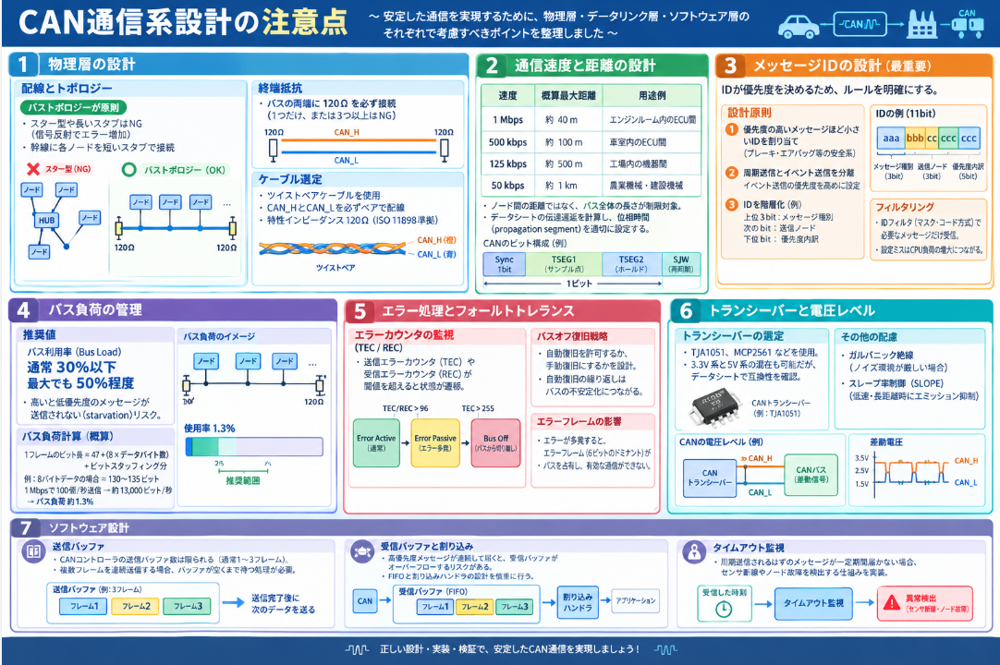

自動車業界はスペースの中に多くの電子システムを組み込むことから配線の過大や、電気ノイズの増加が課題になっていました。
そんな課題の解決案として開発され、今や自動車に限らず産業機械、建設機械と多くの業界の機械に利用されているCANという通信プロトコルがあります。

今日はそんなCANについて説明していきます。

## CANとは
CANとは、**自動車業界で生まれた、高い信頼性とノイズ耐性を持つマルチマスター型のシリアル通信プロトコル**です。

### 一言で言うと

> **「複数の機器が同じ配線（バス）を共有し、優先度付きのメッセージIDで順番を決めながら、ノイズに強い差動信号で通信する方式」** です。

### 主な特徴

| 項目 | 内容 |
|---|---|
| **配線** | CAN_H・CAN_Lの2本の差動信号線 + GND |
| **通信形態** | マルチマスター（誰でも送信可能）、1対多（ブロードキャスト） |
| **同期/非同期** | 非同期（ボーレート方式、UARTに似ている） |
| **速度** | 最高1Mbps（CAN FDなら最大8Mbps） |
| **通信距離** | 最大1km@50kbps〜数十m@1Mbps |
| **強み** | 極めてノイズに強い、優先度制御が組み込み、エラー検出が充実 |
| **弱み** | フレーム構造がやや複雑、ペイロードサイズに制限（古典CANは8バイト） |

### なぜノイズに強いのか

CANは**差動信号**を使います。2本の線（CAN_HとCAN_L）の電位差でデータを表現するため、外部から同じノイズが両線に乗っても、**差分は変わらず**データが破壊されません。これが自動車のエンジンルームのような過酷な環境で使われる理由です。

### UARTやI2Cとの大きな違い

デバイス間通信の代表例としてUART、I2Cを引き合いに主な違いをまとめました。

| 比較項目 | UART | I2C | CAN |
|---|---|---|---|
| 接続形態 | 1対1 | 1対多（マスター主導） | **多対多（マルチマスター）** |
| ノイズ耐性 | 普通 | 普通 | **極めて高い（差動信号）** |
| 優先度制御 | なし | なし | **あり（メッセージIDで自動調停）** |
| 通信距離 | 数m〜十数m | 基板上 | **数百m〜1km** |
| 主な用途 | デバッグ・GPS | 基板上センサ | **自動車・産業機器** |

## 開発背景

CANは、**1980年代の自動車業界が直面した「配線の爆発的増加」という危機**から生まれました。以下、その背景を整理します。

### 1. 当時の自動車業界が直面した課題

__配線の増大（「配線爆発」問題）__

1980年代、自動車の電子化が急速に進みました。エンジン制御、ABS、エアバッグ、エアコン等、電子制御ユニット（ECU）が次々と搭載されるようになりました。

しかし、当時のECU間通信は**ポイントツーポイント接続**（1対1の専用線）が基本でした。

> Boschの公式記事は、[この状況を「**国内のすべての家庭が、互いに専用道路で繋がれているようなもの**」と例えています](https://q-iis10-05.webspace.bosch.com/stories/the-controller-area-network/)。

ECUが増えるほど配線本数が爆発的に増え、以下の問題が深刻化しました。

| 課題 | 内容 |
|---|---|
| **配線の重量増大** | 車両重量の数%を配線ハーネスが占めるようになった |
| **コスト上昇** | 銅線・コネクタ・工数が増大 |
| **信頼性の低下** | 接点が増えるほど故障箇所が増える |
| **柔軟性の欠如** | 新しいECUを追加するたびに専用線を引き直す必要がある |

### 2. CANが解決しようとした3つの核心的課題

__① 配線の共有化（バス型トポロジー）__

複数のECUが**1本の共通配線（バス）** を共有して通信できるようにしました。これにより、新しいECUを追加しても配線本数が線形に増えなくなりました。

__② ノイズ環境での高信頼性__

自動車のエンジンルームは、**点火プラグの火花、モーターの切り替え、電磁界**など、極めて強い電気的ノイズに満ちていました。CANは**差動信号（CAN_H・CAN_L）** を採用し、ノイズに強い通信を実現しました。

__③ リアルタイム性と優先度制御__

ブレーキやエアバッグなど、**緊急のデータを優先して送信する**必要がありました。CANは**メッセージIDによる非破壊的アービトレーション（調停）** を導入し、優先度の高いメッセージが確実に先に送信される仕組みを実現しました。

### 3. 開発の経緯

| 年代 | 出来事 |
|---|---|
| **1983年** | ドイツ・Robert Bosch GmbHで開発開始 |
| **1985年** | BoschとIntelが車載ネットワークデバイス開発で合意。特許出願 |
| **1986年2月** | SAE（米国自動車技術者協会）会議でCANプロトコル発表 |
| **1987年** | Intelから最初のCANコントローラ（82526）の機能サンプル出荷 |
| **1991年** | **メルセデス・ベンツSクラス**に世界初のCAN採用 |

> Boschの研究者Siegfried Daisは、[「**私たちにはシリアルデータ伝送の特別な専門知識は全くなかった。すべてを自分たちで考え出さなければならなかった**」と振り返っています](https://q-iis10-05.webspace.bosch.com/stories/the-controller-area-network/)。

### 4. CANがもたらした変革

CANの登場により、以下が可能になりました。

- **ドライバー支援システム（ADAS）**: 複数のECUが協調して動作
- **自動運転機能**: 多数のセンサー・制御ユニットの同期制御
- **診断機能の標準化**: OBD（車載診断）の実現
- **モジュール化設計**: 新機能の追加が配線変更なしで可能に

## 動作原理

CANの動作原理は、**「複数のECUが同じバスを共有し、メッセージIDの優先度で自動的に送信順位を決めながら、差動信号でノイズに強く通信する」** という仕組みに集約されます。

### 1. 物理層：差動信号（ドミナントとリセッシブ）

CANはCAN_HとCAN_Lの2本線を使い、**電位差**でデータを表現します。

| 状態 | CAN_H | CAN_L | 電位差 | 意味 |
|---|---|---|---|---|
| **ドミナント（Dominant）** | 約3.5V | 約1.5V | 約2V | 常に **論理0** |
| **リセッシブ（Recessive）** | 約2.5V | 約2.5V | 約0V | 常に **論理1** |

**重要な性質**: ドミナント（0）はリセッシブ（1）を**上書き**します。つまり、複数のECUが同時に送信しても、**どこか1つでも0を送ればバス全体は0**になります。これがアービトレーションの基盤になります。

### 2. アービトレーション（調停）：誰が先に送信するか

CANの最大の特徴は、**衝突しても通信が破壊されない**ことです。

__CSMA/CD+AMP の仕組み__

1. **Carrier Sense（搬送波検出）**: バスがアイドル（リセッシブ）になるまで待つ
2. **Multiple Access**: 複数のECUが同じバスに接続
3. **Collision Detection + Arbitration on Message Priority**: 衝突時、メッセージIDで優先度を競い、**優先度の高い（IDの数値が小さい）メッセージが勝つ**

__アービトレーションの具体的動作__

複数のECUが同時に送信を開始すると、**SOF（スタートフレーム）の後にメッセージIDを送出**します。

```
ECU-A ID: 0b 00110... (優先度高 / 緊急ブレーキ)
ECU-B ID: 0b 00111... (優先度低 / 空調温度)

バス上の値:  0  0  1  1  0 ... (ECU-Aが勝利)
                        ↑
                     ここでECU-Bは自分が送った「1」と
                     バス上の「0」が不一致なので、
                     自分の優先度が低いと判断して送信停止
```

各ECUは送信しながら**バスを読み返し（ビット監視）**、自分が送った値とバス上の値が異なれば**即座に送信をやめる**。これにより、優先度の高いメッセージだけが残り、衝突なしに通信が完了します。

### 3. フレーム構造（データフレーム）

CANの1フレームは以下のフィールドで構成されます。

```
┌─────────┬──────────┬────────┬────────┬──────────┬────────┬────────┬──────────┬────────┐
│  SOF    │  仲裁場   │  制御場 │ データ場 │  CRC場   │  ACK場 │  EOF   │  IFS     │
│ (1bit)  │(ID+RTR等) │ ( DLC )│(0~8B)  │(15+1bit)│(2bit)  │(7bit)  │(3bit)    │
│  0(始動)│  ID優先度 │ 長さ   │ ペイロード│ 誤り検出 │ 応答確認│ 終了   │ フレーム │
└─────────┴──────────┴────────┴────────┴──────────┴────────┴────────┴──────────┴────────┘
```

| フィールド | 役割 |
|---|---|
| **SOF** (Start of Frame) | 1ビットのドミナント。フレーム開始の合図 |
| **仲裁場** (Arbitration Field) | メッセージID（11bitまたは29bit）+ RTRビット。優先度決定に使用 |
| **制御場** (Control Field) | DLC (Data Length Code): データ長（0〜8バイト）を指定 |
| **データ場** (Data Field) | 実際のペイロード（最大8バイト） |
| **CRC場** (CRC Field) | 15ビットCRC + デリミタ。伝送誤りを検出 |
| **ACK場** (ACK Field) | 受信したECUがドミナントを返すことで、正常受信を確認 |
| **EOF** (End of Frame) | 7ビットのリセッシブ。フレーム終了 |
| **IFS** (Inter Frame Space) | フレーム間隔。次の送信を待つ |

### 4. エラー検出とフォールトトレランス

CANは以下の**5つのエラー検出機構**を持ち、極めて高い信頼性を実現しています。

| 機構 | 内容 |
|---|---|
| **CRC (Cyclic Redundancy Check)** | 15ビットのCRCでデータの破損を検出 |
| **ACKスロット** | 受信側がドミナントを返さなければ送信側がエラー検出 |
| **ビット監視** (Bit Monitoring) | 送信側が自分の送信ビットとバス上の値を比較 |
| **ビットスタッフィング** (Bit Stuffing) | 5連続同ビット後に反転ビットを挿入。6連続同ビットをエラーと判定 |
| **フレームチェック** | 固定フォーマット部分（EOF等）の違反を検出 |

__エラー発生時の対処__

エラーを検出したノードは、**エラーフレーム（6ビットのドミナント）** を送出し、バス上の全ノードに伝達します。送信側は自動的に再送します。

### 5. 通信の流れ（全体像）

```
1. ECUがデータ送信要求
      ↓
2. バスがアイドル（リセッシブ）か確認（Carrier Sense）
      ↓
3. SOF送出 → メッセージID送出
      ↓
4. 他のECUも送信していた場合、アービトレーション実行
   （IDのビットごとに競合、優先度の高いものが勝利）
      ↓
5. 勝利したECUが残りのフレーム（データ・CRC等）を送信
      ↓
6. 受信ECUがCRCチェック・ACK応答
      ↓
7. フレーム終了（EOF）→ 次のフレーム待ち
```

## メリット/デメリット

CANのメリットとデメリットを、これまでの説明の内容を踏まえて整理します。

### メリット

__1. ノイズに極めて強い__

差動信号（CAN_H・CAN_Lの電位差）でデータを伝送するため、外部からの電磁ノイズが両線に同じように乗っても、**差分は変化しません**。自動車のエンジンルームのような過酷な環境でも安定して通信できます。

__2. 配線の共有化でコスト削減__

複数のECUが**1本のバスを共有**するため、ECUが増えても配線本数が爆発的に増えません。ポイントツーポイント接続と比較して、配線重量・コスト・故障箇所を大幅に削減できます。

__3. 非破壊的アービトレーション__

複数のECUが同時に送信しても、メッセージIDの優先度で自動的に順位が決まり、**データの衝突による破壊が起きません**。優先度の高いメッセージ（例: ブレーキ）が確実に先に送信されます。

__4. エラー検出が極めて充実__

CRC・ACK・ビット監視・ビットスタッフィング・フレームチェックの**5重のエラー検出機構**があります。自動車の安全関連システムでも信頼して使えます。

__5. マルチマスター・ブロードキャスト型__

どのECUも同じバスに接続され、**誰でも送信・受信可能**です。受信側はIDフィルタで必要なメッセージだけを選んで受け取るため、柔軟なシステム設計が可能です。

__6. リアルタイム性__

フレーム長が短く（最大8バイト）、優先度制御が組み込まれているため、**決定論的な遅延**を保証しやすい。制御系のリアルタイム通信に適しています。

### デメリット

__1. ペイロードサイズが小さい__

古典CANでは**1フレームあたり最大8バイト**しかデータを送れません。画像や大容量データの転送には不向きです。（CAN FDで64バイトまで拡張されたが、それでもEthernet等には及ばない）

__2. 通信速度と距離のトレードオフ__

| 速度 | 最大距離（概算） |
|---|---|
| 1 Mbps | 約 40 m |
| 500 kbps | 約 100 m |
| 125 kbps | 約 500 m |
| 50 kbps | 約 1 km |

速度を上げると通信距離が短くなり、長距離を走らせるには速度を落とす必要があります。

__3. フレーム構造がやや複雑__

アービトレーション・CRC・ACK・ビットスタッフィング等、UARTやI2Cに比べて**プロトコルが複雑**です。ソフトウェアでのビットバンギング実装は実質的に不可能で、専用のCANコントローラが必要です。

__4. 1対1通信には不向き__

CANは**ブロードキャスト型**（バス上の全ノードが受信できる）です。特定の1台だけにデータを送りたい場合、ソフトウェア側でIDフィルタリングやアプリケーション層の処理が必要になります。

__5. 配線の終端抵抗が必要__

高速通信時に信号反射を防ぐため、**バスの両端に120Ωの終端抵抗**が必要です。配線トポロジーの設計に注意が必要です。

__6. 消費電力__

差動信号の駆動やビット監視等の処理により、UARTやI2Cに比べて**やや消費電力が大きい**傾向があります。

## 通信系設計の注意点

CAN通信系を設計する際の注意点を、**物理層・データリンク層・ソフトウェア層**の3段階に分けて整理します。

### 1. 物理層の設計

__配線とトポロジー__

- **バストポロジーが原則**: スター型や長いスタブ（分岐線）を作ると信号反射が発生し、通信エラーが増えます。幹線に各ノードを短いスタブで接続する形が理想です。
- **終端抵抗**: バスの**両端に120Ω**を必ず接続します。抵抗が1つだけ、あるいは3つ以上あると信号品質が劣化します。

__ケーブル選定__

- **ツイストペアケーブル**を使用し、CAN_HとCAN_Lを必ずペアで引き回します。
- ケーブルの特性インピーダンスが120Ωに近いものを選びます（ISO 11898準拠品）。

### 2. 通信速度と距離の設計

| 速度 | 概算最大距離 | 用途例 |
|---|---|---|
| 1 Mbps | 約 40 m | エンジンルーム内のECU間 |
| 500 kbps | 約 100 m | 車室内のECU間 |
| 125 kbps | 約 500 m | 工場内の機器間 |
| 50 kbps | 約 1 km | 農業機械・建設機械 |

- **ノード間の距離**ではなく、**バス全体の長さ**が制限対象です。
- 実際の設計では、データシートの伝達遅延を計算し、**位相時間（propagation segment）** を適切に設定する必要があります。

### 3. メッセージIDの設計（最重要）

CANではIDが**優先度**を決めるため、設計段階でIDの割り当てルールを明確にする必要があります。

__設計原則__

- **優先度の高いメッセージほど小さいID**を割り当てる（ブレーキ・エアバッグ等の安全系）
- **周期送信（Periodic）とイベント送信（Event-triggered）を分離**する。イベント送信の優先度を高めに設定し、緊急時に確実に送信できるようにする
- **IDのビット構成を階層化**する（例: 上位3bitでメッセージ種別、次のbitで送信ノード、下位bitで優先度内訳）

__フィルタリング__

受信ノード側は**IDフィルタ（マスク・コード方式）** で必要なメッセージだけを受け取ります。フィルタ設定を誤るとCPU負荷が増大します。

### 4. バス負荷の管理

- CANのバス利用率（Bus Load）は**通常30%以下**、最大でも50%程度に抑えるのが推奨です。
- 利用率が高いと、低優先度のメッセージが送信されない（**starvation**）リスクが増えます。
- 各メッセージの周期・データ長・送信ノード数をリスト化し、**バス負荷を事前計算**します。

```
バス負荷計算（概算）:
1フレームのビット長 ≈ 47 + (8 × データバイト数) + ビットスタッフィング分
例: 8バイトデータの場合 ≈ 130〜135ビット
1Mbpsで100個/秒送信 → 約13,000ビット/秒 → バス負荷約1.3%
```

### 5. エラー処理とフォールトトレランス

- **エラーカウンタ（TEC/R EC）** の監視: 送信エラーカウンタ（TEC）や受信エラーカウンタ（REC）が閾値を超えると、ノードは**Error Passive**や**Bus Off**状態に遷移します。Bus Offになったノードはバスから切り離されるため、上位ソフトウェアで検出・復旧処理が必要です。
- **バスオフ復旧戦略**: 自動復旧を許可するか、手動復旧にするかを設計時に決定します。自動復旧が繰り返されるとバスが不安定になる場合があります。
- **エラーフレームの影響**: エラーが多発すると、エラーフレーム（6ビットのドミナント）がバスを占有し、有効な通信ができなくなります。

### 6. トランシーバーと電圧レベル

- **CANトランシーバー**（TJA1051、MCP2561等）を選定します。3.3V系と5V系のトランシーバーが混在しても、CAN_H・CAN_Lの差動電位が規格内であれば通信可能ですが、データシートで互換性を確認します。
- **ガルバニック絶縁**: ノイズ環境が厳しい場合、トランシーバーに絶縁型を選定します。
- **スレープ率制御（SLOPE）**: 低速・長距離通信時にエミッションを抑えるため、立ち上がり/立ち下がりを緩やかにする機能があります。

### 7. ソフトウェア設計

- **送信バッファ**: CANコントローラの送信バッファ数は限られています（通常1〜3フレーム）。複数フレームを連続送信する場合、バッファが空くまで待つ処理が必要です。
- **受信バッファと割り込み**: 高優先度メッセージが連続して届くと受信バッファがオーバーフローするリスクがあります。FIFOと割り込みハンドラの設計を慎重に行います。
- **タイムアウト監視**: 周期送信されるはずのメッセージが一定期間届かない場合、センサ断線やノード故障を検出する仕組みを実装します。



## 総括

CANは、**「1本の差動信号バスを複数の機器で共有し、メッセージIDの優先度で自動的に衝突を解決しながら、ノイズに強く高信頼性なリアルタイム通信を行う自動車・産業機器向けのシリアル通信プロトコル」**です。


